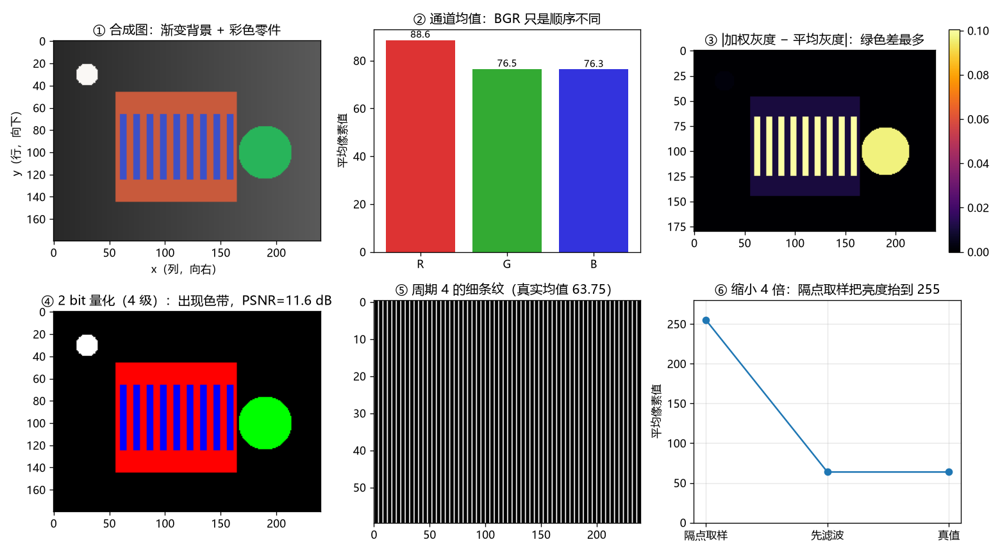
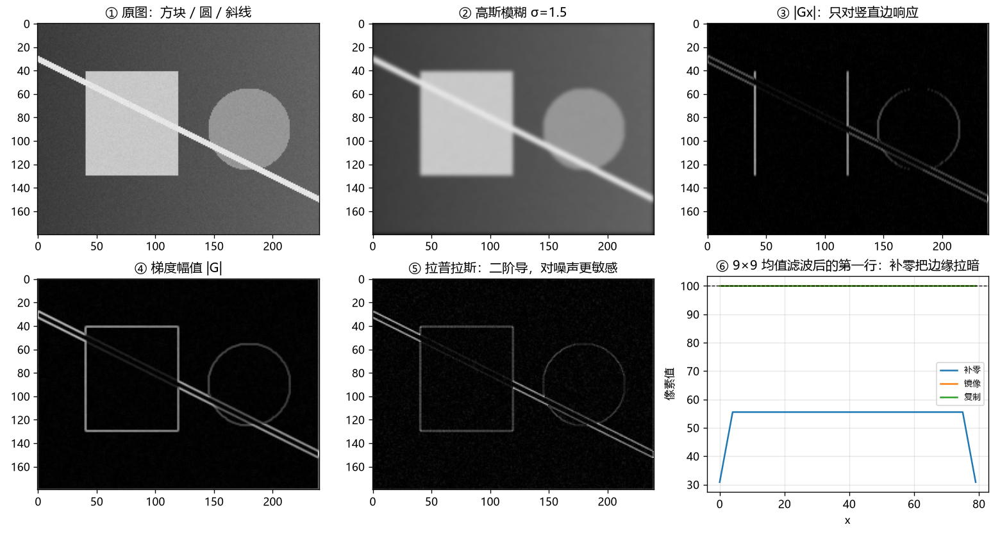
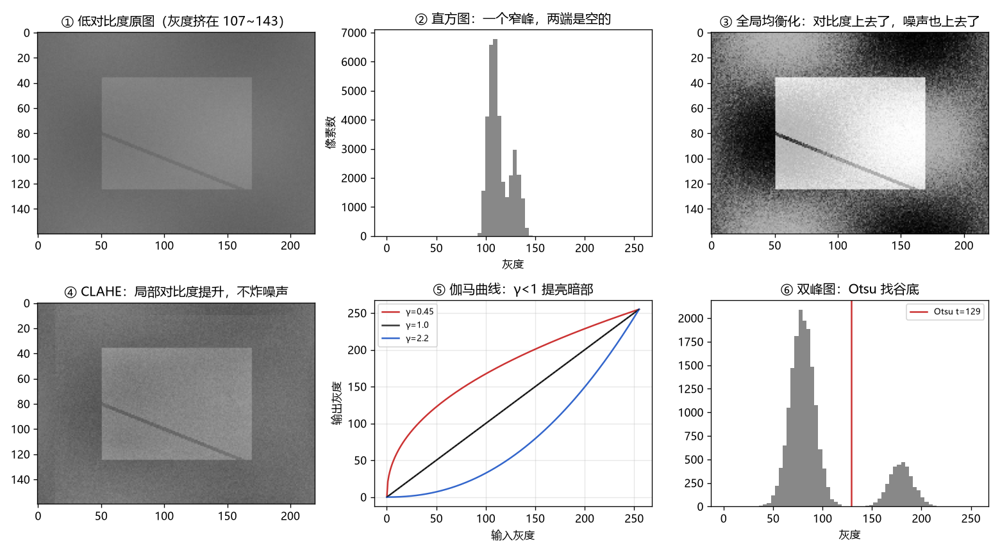
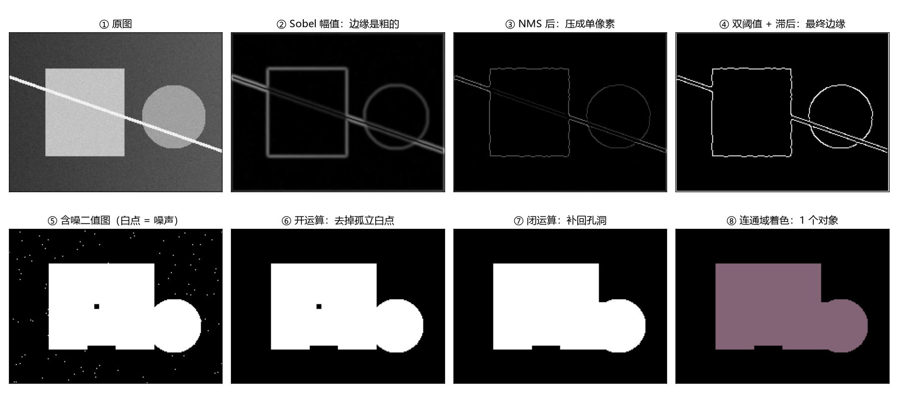
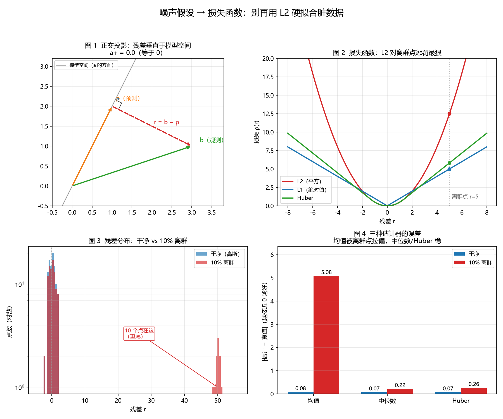
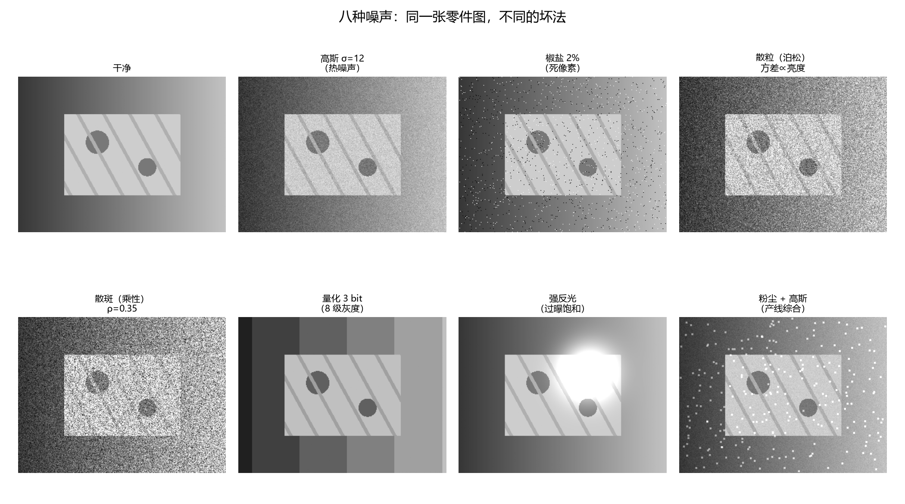
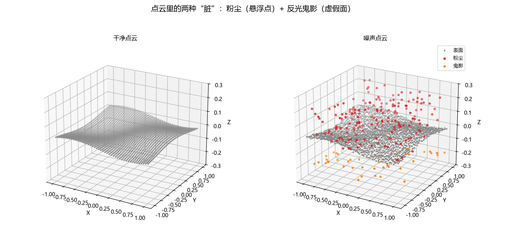

# 配套示例代码

学习笔记里出现的代码，在这里是**可直接运行、带断言**的版本。
每篇笔记 → 一个脚本，函数名与笔记一致，方便对照。

## 目录

```
codes/
├── requirements.txt
├── S0-图像基础与工具链/
│   ├── 00_toolchain.py          # NumPy：shape/axis、dtype、广播、视图、坐标
│   ├── 01_image_basics.py       # 图像：BGR、灰度权重、量化 PSNR、混叠
│   ├── 02_convolution.py        # 卷积：手写、im2col、可分离高斯、Sobel、边界
│   ├── 03_histogram.py          # 直方图：均衡、CLAHE、伽马、Otsu
│   └── 04_edges_morphology.py   # 边缘：Canny 五步、形态学、连通域
├── M0-计算机视觉导论/
│   ├── 03_noise_robust.py       # 正交投影、损失曲线、残差直方图、估计器对比
│   └── 04_noise_gallery.py      # 八种噪声图像 + 点云粉尘/鬼影
├── M1-数学与几何基础/
    ├── 01_rotation.py           # 旋转：hat/vee、exp/log、四元数、det 陷阱
    ├── 01_so3_visual.py         # 图示：旋转效果、SO(3) 的球、线性化误差
    ├── 02_least_squares.py      # 正规方程、GN、LM、Huber + IRLS
    ├── 03_kabsch.py             # SVD 求 R,t、det 修正、共线退化
    └── 04_kalman.py             # 误差传播、高斯融合、KF、马氏距离
└── M2-相机模型与标定/
    ├── 01_pinhole.py            # 针孔：fx=f/dx、投影/反投影、mm/px、resize/crop 改 K
    ├── 02_distortion.py         # 畸变：径向/切向、桶形/枕形、迭代去畸变、视场变化
    ├── 03_zhang_calib.py        # 标定：DLT 单应、B=K⁻ᵀK⁻¹ 闭式解、手写 LM、退化演示
    ├── 04_pnp_stereo.py         # PnP：DLT+LM、RANSAC 去外点、双目视差与 Z² 精度
    └── 05_handeye_cutcircle.py  # 手眼：切割圆方案、Kabsch、单高度/共线退化、H 转置坑
```

编号和笔记对齐：`01_*` ↔ M1 第 1 篇，`02_*` ↔ M1 第 2 篇……M0 只有噪声篇有代码。

## 怎么读这些脚本

代码是**按教学写的**，不是按"最短"写的：

1. **先看文件头的 docstring**：它列出这个脚本要回答的几个问题；
2. **再看每个函数的 docstring**：里面是公式、参数含义、以及"最容易错的地方"；
3. **行内注释解释"为什么"**：比如 `[w]x @ v == w × v`、`axis=0 表示按列`、
   `w[:, None] 把 (m,) 变成 (m,1)` 这类 numpy 写法；
4. **最后看 `main()`**：它按照从易到难的顺序调用各个 `demo_*`。

看不懂某一行时，先看它上面那段注释；还看不懂就回到笔记对应小节，
笔记里的推导比代码注释更细。

## 环境

```powershell
cd codes
python -m venv .venv
.venv\Scripts\activate
pip install -r requirements.txt
```

依赖只有 `numpy` + `scipy` + `matplotlib`（scipy 用于旋转互转、S0 的参考卷积/连通域；matplotlib 用于图示脚本）。

## 运行

```powershell
python S0-图像基础与工具链/00_toolchain.py
python S0-图像基础与工具链/01_image_basics.py --save
python S0-图像基础与工具链/02_convolution.py --save
python S0-图像基础与工具链/03_histogram.py --save
python S0-图像基础与工具链/04_edges_morphology.py --save
python M0-计算机视觉导论/03_noise_robust.py            # 弹窗；加 --save 才存图
python M1-数学与几何基础/01_rotation.py
python M1-数学与几何基础/01_so3_visual.py              # 弹窗；加 --save 才存图
python M1-数学与几何基础/02_least_squares.py
python M1-数学与几何基础/03_kabsch.py
python M1-数学与几何基础/04_kalman.py
python M2-相机模型与标定/01_pinhole.py
python M2-相机模型与标定/02_distortion.py
python M2-相机模型与标定/03_zhang_calib.py
python M2-相机模型与标定/04_pnp_stereo.py
python M2-相机模型与标定/05_handeye_cutcircle.py
```

## 脚本 ↔ 笔记对照

| 脚本 | 笔记 | 关键输出（会对上的数字） |
|---|---|---|
| `00_toolchain.py` | [`0-环境与工具链.md`](../notes/S0-图像基础与工具链/0-环境与工具链.md) | `uint8(200)+100=44`；`mean(axis=0) -> (W,3)`；视图 `base is img` |
| `01_image_basics.py` | [`1-图像是什么.md`](../notes/S0-图像基础与工具链/1-图像是什么.md) | 2 bit PSNR `11.56 dB`；纯绿加权 `149.7` vs 平均 `85.0`；隔点取样 `255` vs 真值 `63.75` |
| `02_convolution.py` | [`2-卷积与滤波.md`](../notes/S0-图像基础与工具链/2-卷积与滤波.md) | 手写 vs scipy `1.78e-15`；3×3 im2col 快 `164×`；可分离高斯快 `49.5×`；补零角点 `30.86` |
| `03_histogram.py` | [`3-直方图与点运算.md`](../notes/S0-图像基础与工具链/3-直方图与点运算.md) | 均衡 σ `11.32→72.58`；CLAHE 背景噪声 `2.4×` vs 全局 `8.6×`；Otsu `129`，光照不均准确率 `84.71%` |
| `04_edges_morphology.py` | [`4-边缘检测与形态学.md`](../notes/S0-图像基础与工具链/4-边缘检测与形态学.md) | NMS 压到 `24.8%`；滞后 `1671→1753`；闭运算 `+59` 像素；连通域 `92→1` |
| `03_noise_robust.py` | [`3-噪声与误差模型.md`](../notes/M0-计算机视觉导论/3-噪声与误差模型.md) | 10% 离群点下：均值偏 `5.08`，中位数偏 `0.22`，Huber 偏 `0.26` |
| `04_noise_gallery.py` | [`3-噪声与误差模型.md`](../notes/M0-计算机视觉导论/3-噪声与误差模型.md) §6 | 八种噪声图像 + 点云粉尘/鬼影 |
| `01_rotation.py` | [`1-旋转.md`](../notes/M1-数学与几何基础/1-旋转.md) | exp/log 往返误差 `4.4e-11`；det=1 但 `RᵀR≠I` |
| `01_so3_visual.py` | [`1-旋转.md`](../notes/M1-数学与几何基础/1-旋转.md) §1.4 / §2.2 | 4 张图：旋转效果、扫掠、SO(3) 的球、线性化误差 |
| `02_least_squares.py` | [`2-最小二乘与LM.md`](../notes/M1-数学与几何基础/2-最小二乘与LM.md) | GN 内点 RMSE `0.0903` vs Huber `0.0420` |
| `03_kabsch.py` | [`3-SVD求刚体变换.md`](../notes/M1-数学与几何基础/3-SVD求刚体变换.md) | 镜像数据：修正后 det `+1` 残差 `6.962`，不修正 det `-1` 残差 `1.146` |
| `04_kalman.py` | [`4-协方差传播与卡尔曼.md`](../notes/M1-数学与几何基础/4-协方差传播与卡尔曼.md) | 传播 vs 蒙特卡洛误差 `0.4%`；KF 收敛到 `[5.063, 1.015]` |
| `01_pinhole.py` | [`1-针孔模型与内参.md`](../notes/M2-相机模型与标定/1-针孔模型与内参.md) | `fx=f/dx=2318.84`；500 mm 处 `0.216 mm/px`；反投影误差 `3.47e-17`；半尺寸投影恰好一半 |
| `02_distortion.py` | [`2-畸变与去畸变.md`](../notes/M2-相机模型与标定/2-畸变与去畸变.md) | 四角位移 `27.23/29.26/26.15/28.18 px`；迭代 3 次残差 `2.16e-03 px`；顺序错差 `18.69 px`；视场需放大 `1.0388` |
| `03_zhang_calib.py` | [`3-张正友标定.md`](../notes/M2-相机模型与标定/3-张正友标定.md) | 单应 `0.253 px`；线性 `fx=1798.94`（真值 1800）；LM 后 RMSE `0.258 px`；2 姿态 `rank=4` |
| `04_pnp_stereo.py` | [`4-外参-PnP与双目.md`](../notes/M2-相机模型与标定/4-外参-PnP与双目.md) | PnP DLT `0.414°` → LM `0.071°`；30% 外点 `170.7°` → RANSAC `0.026°`；1 m 视差 `139.13 px` |
| `05_handeye_cutcircle.py` | [`5-手眼标定-切割圆实战.md`](../notes/M2-相机模型与标定/5-手眼标定-切割圆实战.md) | 8 点 `RMS 0.0165 mm` / 旋转 `0.0009°`；单高度旋转错 `90.10°`；共线 `90.40°` 但残差 0；转置解 RMS `1.696 mm`；纯平移 AX=XB 残差 `8.4e-16` |

## 预览
















> 由各自脚本加 `--save` 生成（默认只弹窗、不写文件）。

## 约定

- **无外部数据**：全部随机生成 + 固定种子，任何机器上结果一致；
- **带断言**：脚本末尾会打印 `ALL PASS` / `ALL DONE`，失败会直接报错；
- **纯函数 + `main()`**：函数可以单独 import 到别的脚本里复用；
- **注释对着笔记写**：公式旁边的注释就是笔记里的那句话。

## 后续

- 每学完一篇新笔记，就在这里加一个同编号脚本；
- 有真实数据的实验（棋盘格、点云）放到 `labs/`，这里只放**最小可运行示例**。
