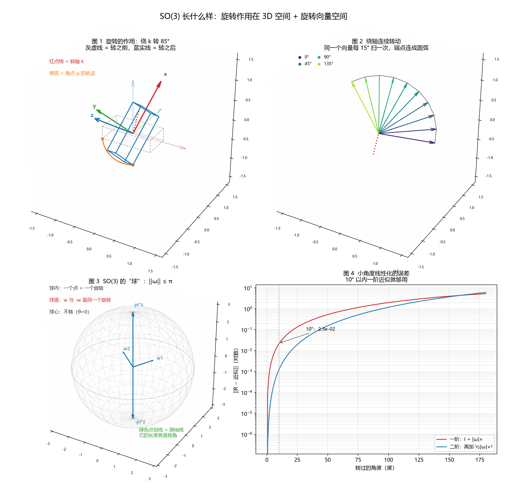

# 配套示例代码

学习笔记里出现的代码，在这里是**可直接运行、带断言**的版本。
每篇笔记 → 一个脚本，函数名与笔记一致，方便对照。

## 目录

```
codes/
├── requirements.txt
└── M0-数学与几何基础/
    ├── 02_rotation.py           # 旋转：hat/vee、exp/log、四元数、det 陷阱
    ├── 02_so3_visual.py         # 图示：旋转效果、SO(3) 的球、线性化误差
    ├── 03_least_squares.py      # 正规方程、GN、LM、Huber + IRLS
    ├── 04_kabsch.py             # SVD 求 R,t、det 修正、共线退化
    ├── 05_kalman.py             # 误差传播、高斯融合、KF、马氏距离
    └── 06_noise_robust.py       # 正交投影、均值/中位数/Huber、重尾诊断
```

编号和笔记对齐：`02_*` ↔ 第 2 篇，`03_*` ↔ 第 3 篇……导论（第 1 篇）没有代码。

## 怎么读这些脚本

代码是**按教学写的**，不是按"最短"写的：

1. **先看文件头的 docstring**：它列出这个脚本要回答的几个问题；
2. **再看每个函数的 docstring**：里面是公式、参数含义、以及"最容易错的地方"；
3. **行内注释解释"为什么"**：比如 `[w]x @ v == w × v`、`axis=0 表示按列`、
   `w[:, None] 把 (m,) 变成 (m,1)` 这类 numpy 写法；
4. **最后看 `main()`**：它按照从易到难的顺序调用各个 `demo_*`。

看不懂某一行时，先看它上面那段注释；还看不懂就回到笔记对应小节，
笔记里的推导比代码注释更细。

## 环境

```powershell
cd codes
python -m venv .venv
.venv\Scripts\activate
pip install -r requirements.txt
```

依赖只有 `numpy` + `scipy` + `matplotlib`（scipy 仅用于 02 里的互转对照；matplotlib 只有 02_so3_visual 用）。

## 运行

```powershell
python M0-数学与几何基础/02_rotation.py
python M0-数学与几何基础/02_so3_visual.py          # 弹窗显示；加 --save 才存图
python M0-数学与几何基础/03_least_squares.py
python M0-数学与几何基础/04_kabsch.py
python M0-数学与几何基础/05_kalman.py
```

## 脚本 ↔ 笔记对照

| 脚本 | 笔记 | 关键输出（会对上的数字） |
|---|---|---|
| `02_rotation.py` | [`2-旋转.md`](../notes/M0-数学与几何基础/2-旋转.md) | exp/log 往返误差 `4.4e-11`；det=1 但 `RᵀR≠I` |
| `02_so3_visual.py` | [`2-旋转.md`](../notes/M0-数学与几何基础/2-旋转.md) §1.4 / §2.2 | 4 张图：旋转效果、扫掠、SO(3) 的球、线性化误差 |
| `03_least_squares.py` | [`3-最小二乘与LM.md`](../notes/M0-数学与几何基础/3-最小二乘与LM.md) | GN 内点 RMSE `0.0903` vs Huber `0.0420` |
| `04_kabsch.py` | [`4-SVD求刚体变换.md`](../notes/M0-数学与几何基础/4-SVD求刚体变换.md) | 镜像数据：修正后 det `+1` 残差 `6.962`，不修正 det `-1` 残差 `1.146` |
| `05_kalman.py` | [`5-协方差传播与卡尔曼.md`](../notes/M0-数学与几何基础/5-协方差传播与卡尔曼.md) | 传播 vs 蒙特卡洛误差 `0.4%`；KF 收敛到 `[5.063, 1.015]` |
| `06_noise_robust.py` | [`6-噪声与误差模型.md`](../notes/M0-数学与几何基础/6-噪声与误差模型.md) | 10% 离群点下：均值偏 `5.08`，中位数偏 `0.22`，Huber 偏 `0.26` |

## 预览



> 由 `python M0-数学与几何基础/02_so3_visual.py --save` 生成（默认只弹窗、不写文件）。

## 约定

- **无外部数据**：全部随机生成 + 固定种子，任何机器上结果一致；
- **带断言**：脚本末尾会打印 `ALL PASS` / `ALL DONE`，失败会直接报错；
- **纯函数 + `main()`**：函数可以单独 import 到别的脚本里复用；
- **注释对着笔记写**：公式旁边的注释就是笔记里的那句话。

## 后续

- 每学完一篇新笔记，就在这里加一个同编号脚本；
- 有真实数据的实验（棋盘格、点云）放到 `labs/`，这里只放**最小可运行示例**。
